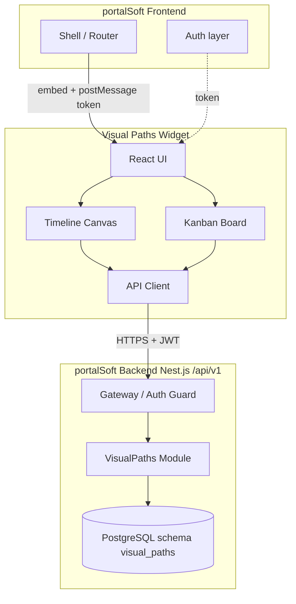

# Техническое задание: Visual Paths (standalone → виджет portalSoft)

**Версия документа:** 1.1  
**Дата:** 2026-08-09  
**Статус:** черновик для согласования  
**Заказчик:** portalSoft  
**Тип продукта:** сначала **самостоятельное приложение** (MVP); целевая форма — виджет + API в Nest.js portalSoft

---

## 0. Стратегия поставки: Standalone First

### 0.1. Решение

**Да — сначала независимое приложение Visual Paths**, без ожидания разработчиков portalSoft. После подтверждения UX — перенос в виджет и API-модуль portal.

### 0.2. Зачем

| Плюс | Пояснение |
|------|-----------|
| Скорость | Не блокируемся на CORS, postMessage, релизном цикле portal |
| Проверка идеи | «Пощупать» схему + канбан вживую |
| Дешёвый провал | Если концепт не зайдёт — monorepo portal не трогали |
| Чистая граница | Свой API ≈ будущий \/api/v1/visual-paths\ |

### 0.3. Правила, чтобы перенос был дешёвым

1. Стек: Nest.js + PostgreSQL, React + TypeScript.
2. \AuthProvider\ (\getAccessToken\, \getUser\): standalone = свой login; widget = postMessage/Host.
3. API-клиент только на \/api/v1/visual-paths\ (+ auth/health в standalone).
4. Корень UI — \<VisualPathsApp />\ без shell portal.
5. Даже в standalone есть \companyId\ (demo-tenant).
6. В MVP не делать: SSO portal, iframe-контракт, CSP Host.

### 0.4. Режимы

| Режим | Auth | API |
|-------|------|-----|
| \standalone\ (сейчас) | упрощённый login | свой Nest |
| \widget\ (потом) | token от portal | \{portal}/api/v1\ |

Env: \VITE_APP_MODE=standalone|widget\, \VITE_API_BASE_URL\.

### 0.5. Урезание MVP

Одна компания/простая регистрация; канбан сначала CRUD+DnD+описание/assignees; файлы и postMessage — позже.

### 0.6. Когда переходить к виджету

Демо: цель → ≥2 пути → канбан узла → прогресс на схеме — и заказчик хочет это в portal.

---

## 1. Цель и границы продукта

### 1.1. Бизнес-цель

Дать пользователю возможность **визуально спланировать и вести достижение большой цели** через **параллельные пути** на **временной шкале**. Каждый путь — упорядоченная цепочка задач; выполнение цепочек в совокупности приводит к реализации цели.

### 1.2. Продуктовая метафора

| Понятие | Смысл |
|---------|--------|
| **Цель (Goal)** | Крупный результат (эпик верхнего уровня) |
| **Путь (Path)** | Одна линия/дорожка задач, ведущая к цели (или к общей точке слияния) |
| **Узел задачи (Node)** | Задача на схеме (визуально — кружок/узел) |
| **Связь (Edge)** | Направленная зависимость «A → B»; на стрелке — оценка/длительность перехода |
| **Временная шкала (Timeline)** | Ось слева направо; положение узлов отражает плановое время |
| **Канбан задачи** | Оперативное исполнение конкретной задачи (карточки/подзадачи внутри узла) |

### 1.3. Визуальный ориентир

- **Схема путей:** минимально необходимая подмножество возможностей [diagrams.net / draw.io](https://app.diagrams.net/) — холст, узлы, рёбра, зум/пан, выделение, перетаскивание, подписи на рёбрах. **Не** требуется полный редактор диаграмм (UML-библиотеки, экспорт Visio и т.п.).
- **Канбан:** ориентир по UX — [Кайтен](https://kaiten.ru): карточки, колонки, drag-and-drop, комментарии, чек-листы, метки, ответственные, сроки, фильтры, история. Колонок **ровно четыре** (фиксированный поток):

  1. **Задача** (Backlog / To Do)  
  2. **В работе** (In Progress)  
  3. **Тестирование** (QA / Review)  
  4. **Готово** (Done)

### 1.4. Форма поставки

**Этап A (сейчас):** standalone-приложение (свой frontend + свой Nest API), локальный/отдельный деплой.  
**Этап B (после ОКки):** UI как виджет portalSoft; API — модуль в Nest portal (или прокси на тот же контракт). В обоих случаях UI — **HTTP-клиент** без прямого доступа к БД.

### 1.5. Вне scope (v1)

- Прямая интеграция с доменами portal (finance, warehouse, docs, task и т.д.), кроме явно описанных API виджета.
- WebSocket / realtime-чаты (опционально — polling или refresh по фокусу окна).
- Полноценный draw.io-совместимый формат файлов.
- Мобильное native-приложение (адаптив web обязателен).
- AI-генерация планов (может быть roadmap v2).

---

## 2. Глоссарий

| Термин | Определение |
|--------|-------------|
| Host / Portal | Основное frontend-приложение portalSoft |
| Widget | UI Visual Paths, встраиваемый в Host |
| Tenant | Компания (`companyId` из JWT) |
| Access token | JWT Bearer для `/api/v1` |
| Node card / Kanban card | Карточка внутри канбана узла (подзадача/работа) |
| WIP | Ограничение числа карточек в колонке (настраиваемо) |
| Lead time | Время от создания карточки до Done |
| Cycle time | Время от «В работе» до Done |

---

## 3. Пользователи и роли

### 3.1. Роли portalSoft, допускаемые к виджету (v1)

| Роль | Доступ |
|------|--------|
| `ADMINISTRATOR` | Полный доступ ко всем целям компании + админ-настройки виджета |
| `COMPANY_ADMINISTRATOR` | Полный доступ в рамках `companyId` |
| `CUSTOMER` / сотрудники компании (уточнить список ролей portal) | CRUD по целям/путям, где пользователь — владелец, участник или имеет явное право |

**Правило:** виджет **не подменяет** `companyId`. Tenant берётся из JWT / контекста Host.

### 3.2. Роли внутри цели (RBAC виджета)

| Роль на Goal | Права |
|--------------|--------|
| `owner` | Удаление цели, управление участниками, полное редактирование схемы и канбанов |
| `editor` | Редактирование схемы, узлов, рёбер, канбана |
| `member` | Работа с канбаном назначенных карточек; просмотр схемы; комментарии |
| `viewer` | Только просмотр схемы и канбана |

Назначение ролей — owner / company admin.

---

## 4. Пользовательские сценарии (ключевые)

### UC-01. Создать цель
Пользователь создаёт Goal: название, описание, плановая дата завершения, опционально цвет/иконка. Открывается пустой холст со шкалой времени и «якорем цели» справа (или маркером цели).

### UC-02. Собрать параллельные пути
Пользователь добавляет узлы (кружки), размещает их на шкале (drag по X ≈ время), соединяет стрелками. На стрелке задаёт длительность (часы/дни). Можно создать 2+ независимых пути, сходящихся в цель или в промежуточный узел-слияние.

### UC-03. Оценить план по времени
Система считает критический путь и суммарную длительность путей; подсвечивает конфликты (узел раньше предшественника; выход за дедлайн цели).

### UC-04. Открыть канбан задачи
Двойной клик по узлу → экран/модальный полноэкранный канбан этой задачи (4 колонки). Пользователь ведёт карточки до Done.

### UC-05. Связать прогресс узла со схемой
Прогресс узла на схеме отражает % карточек в Done (или ручной статус узла — см. §6.3). Цвет/обводка узла меняется по статусу.

### UC-06. Совместная работа
Несколько участников компании работают с одной целью; конфликты редактирования схемы — optimistic lock / версия документа схемы.

### UC-07. Встраивание в portal
Пользователь открывает раздел portal → виджет получает token и контекст от Host → загружает список целей компании.

---

## 5. Функциональные требования

### 5.1. Модуль «Цели» (Goals)

**FR-G-01** CRUD целей в рамках tenant.  
**FR-G-02** Список целей: фильтр (мои / все доступные), поиск по названию, сортировка по дате обновления / дедлайну / прогрессу.  
**FR-G-03** Карточка цели: название, описание (markdown), дедлайн, статус (`draft` | `active` | `completed` | `archived`), прогресс (агрегат), владелец, участники.  
**FR-G-04** Архивация вместо жёсткого удаления по умолчанию; hard-delete — только owner/admin.  
**FR-G-05** Дублирование цели (копия схемы + опционально без канбан-карточек).

### 5.2. Модуль «Схема путей» (Graph / Timeline Canvas)

**FR-C-01** Холст 2D: pan (СКМ / Space+drag), zoom (колесо, pinch), fit-to-content, reset view.  
**FR-C-02** Временная шкала по оси X (дни/недели/месяцы — переключаемый масштаб). Вертикальные линии-грид по датам.  
**FR-C-03** Узел задачи: форма «кружок» (или скруглённый диск); подпись названия; индикатор прогресса; цвет статуса.  
**FR-C-04** Создание узла: кнопка «+», dual-click на пустом месте, или из палитры.  
**FR-C-05** Перемещение узла drag-and-drop; привязка позиции X к дате (snap к дню/неделе — настройка).  
**FR-C-06** Рёбра: направленные стрелки A→B; создание протягиванием от порта узла.  
**FR-C-07** Подпись на ребре: длительность (`durationValue` + `durationUnit`: hour|day|week).  
**FR-C-08** Запрет циклов в графе зависимостей (DAG). При попытке создать цикл — ошибка UI + API.  
**FR-C-09** Множество путей: визуальные «дорожки» (lanes) по Y опционально; или свободное размещение по Y с группировкой pathId.  
**FR-C-10** Узел-цель: один терминальный узел типа `goal_anchor` (или флаг `isGoalTarget`) — точка схода.  
**FR-C-11** Выделение: single / multi-select (Shift), Delete/Backspace — удаление с подтверждением.  
**FR-C-12** Undo/Redo локально в сессии редактора (стек ≥ 50 шагов); сервер хранит актуальную версию.  
**FR-C-13** Мини-карта (опционально v1.1); в v1 — достаточно zoom controls.  
**FR-C-14** Двойной клик по узлу задачи → переход в канбан (§5.3). Двойной клик по `goal_anchor` — свойства цели.  
**FR-C-15** Контекстное меню узла: открыть канбан, свойства, дублировать, удалить, назначить path.  
**FR-C-16** Панель свойств выбранного элемента (справа): название, описание, даты, длительность ребра, ответственный узла.  
**FR-C-17** Авто-раскладка «по критическому пути» (кнопка) — опционально v1.1; в v1 — ручная раскладка обязательна.  
**FR-C-18** Экспорт схемы: PNG, SVG; импорт/экспорт JSON собственной схемы (не .drawio).  
**FR-C-19** Режим «только просмотр» для `viewer`.  
**FR-C-20** Подсветка критического пути; предупреждение, если суммарная длительность пути > дедлайна цели.

**Минимальный «draw.io-like» набор (обязателен):**
- Nodes, edges, labels, drag, connect, zoom/pan, selection, delete, property panel.
- **Не обязательны:** слои, произвольные шейпы, библиотеки фигур, connectors waypoints вручную (допускаются прямые/ортогональные рёбра из коробки).

### 5.3. Модуль «Канбан задачи» (Node Board)

Каждый узел типа `task` имеет **свою доску** с 4 колонками.

#### 5.3.1. Колонки (фиксированные)

| key | Название UI | Порядок |
|-----|-------------|---------|
| `todo` | Задача | 1 |
| `in_progress` | В работе | 2 |
| `testing` | Тестирование | 3 |
| `done` | Готово | 4 |

**FR-K-01** Drag-and-drop карточек между колонками и внутри колонки (порядок `position`).  
**FR-K-02** Создание карточки в колонке (кнопка «+», быстрый ввод названия).  
**FR-K-03** Карточка: title, description (markdown), assignees[], labels[], priority (`low`|`medium`|`high`|`critical`), dueDate, estimate (часы), spentTime (учёт времени), checklist, attachments meta (если файлы — через отдельный контракт; v1 можно без upload — только ссылки), coverColor.  
**FR-K-04** Чек-листы: пункты, done/undone, опционально assignee и due на пункт.  
**FR-K-05** Комментарии к карточке (текст, автор, время); редактирование/удаление своего комментария.  
**FR-K-06** Метки уровня доски (CRUD меток board-scoped).  
**FR-K-07** Фильтры: по assignee, label, priority, overdue, search.  
**FR-K-08** WIP-лимит на колонку (настройка доски); предупреждение/блок при превышении (режим: warn | block).  
**FR-K-09** История изменений карточки (аудит: перемещения, смена полей).  
**FR-K-10** Блокировка карточки (`blocked` + reason); визуальный индикатор.  
**FR-K-11** Напоминания о dueDate (через уведомления portal, если есть канал; иначе in-app badge в виджете).  
**FR-K-12** Шаблоны карточек на уровне цели или доски.  
**FR-K-13** Массовые действия: переместить, назначить, добавить метку, удалить.  
**FR-K-14** Клавиатура: Esc закрыть, стрелки между карточками (желательно).  
**FR-K-15** Возврат со схемы: breadcrumb «Цель → Узел → Канбан»; кнопка «К схеме» с фокусом на узел.  
**FR-K-16** Прогресс узла = `doneCount / totalCards` (карточки не в архиве); при 0 карточек — статус узла задаётся вручную.  
**FR-K-17** Архивация карточек из Done; просмотр архива.  
**FR-K-18** Учёт времени: ручной лог + простой таймер (start/stop) на карточке.

> «Полный функционал» канбана в рамках 4 колонок означает: карточки, D&D, описаниe, люди, метки, приоритет, сроки, чек-листы, комментарии, фильтры, WIP, блокировки, история, шаблоны, архив, учёт времени — по аналогии с возможностями Кайтен, без модулей Scrum/Gantt/Service Desk.

### 5.4. Аналитика (минимум v1)

**FR-A-01** На цели: % прогресса, число узлов, число завершённых узлов, статус критического пути.  
**FR-A-02** На доске: количество по колонкам, overdue count.  
**FR-A-03** (v1.1) Lead/Cycle time, CFD — backlog.

### 5.5. Уведомления (v1 — минимально)

**FR-N-01** In-widget список событий: назначение на карточку, комментарий, приближение dueDate, смена статуса узла.  
**FR-N-02** Интеграция с notification-каналом portal — отдельная задача; в v1 достаточно хранения events + polling.

---

## 6. Правила предметной области

### 6.1. Граф

- Граф зависимостей — **ориентированный ациклический (DAG)**.
- Ребро означает: «B нельзя считать готовым к старту, пока A не завершён» (мягкое правило UI + жёсткая опция в настройках цели `enforceDependencies`).
- Длительность на ребре — **оценка интервала/лага** между завершением A и стартом B **или** длительность выполнения A (зафиксировать в настройках цели: `edgeDurationMeans = lag | predecessor_duration`). **Рекомендация v1:** `predecessor_duration` — на стрелке время решения предыдущей задачи (как в формулировке заказчика).

### 6.2. Время на шкале

- У узла: `plannedStart`, `plannedEnd` (date-time или date).  
- При перемещении по X пересчитывается `plannedStart`; `plannedEnd` = start + собственная оценка или из входящего ребра.  
- Часовой пояс: UTC в API; отображение — TZ пользователя из Host/browser.

### 6.3. Статус узла

| status | Условие |
|--------|---------|
| `not_started` | нет карточек в in_progress/testing/done или ручной |
| `in_progress` | есть активность на доске |
| `done` | все карточки в done/archive **или** ручное завершение при пустой доске |
| `blocked` | есть blocked-карточки или ручной флаг |

### 6.4. Параллельные пути

- Path — именованная группа узлов (`pathId`, name, color, orderY).  
- Пути могут сходиться в общий узел или в `goal_anchor`.  
- Независимые пути допускают параллельное исполнение.

---

## 7. Архитектура

### 7.1. Высокоуровневая схема



### 7.2. Варианты встраивания

| Вариант | Рекомендация |
|---------|--------------|
| **iframe** | Предпочтительно для изоляции; token через `postMessage` |
| **micro-frontend / npm-пакет** | Общий auth Host (axios interceptors) |
| Отдельный origin | Origin в `CORS_ORIGINS`; login через Host или OTP portal |

### 7.3. Принцип интеграции (обязательный)

Виджет **не вызывает** бизнес-домены portal (finance, warehouse, docs, task…).  
Работает только с:
- auth/health контрактами portal (как клиент);
- **собственными** эндпоинтами модуля Visual Paths.

### 7.4. Frontend-стек виджета (рекомендация)

| Слой | Технология |
|------|------------|
| UI | React 18+ + TypeScript |
| Состояние | Zustand или Redux Toolkit |
| Canvas | React Flow / XYFlow **или** Konva / Pixi — выбрать на этапе дизайна; требование: 200+ узлов без деградации |
| DnD канбан | `@dnd-kit` |
| Запросы | fetch/axios; единый error mapper `alertCode` |
| Сборка | Vite; library mode или отдельный static deploy |

### 7.5. Backend-стек

| Слой | Технология |
|------|------------|
| Framework | Nest.js (модуль `VisualPathsModule` в monorepo/portal) |
| ORM | как в portal (Drizzle/TypeORM — не диктовать; отдельная schema/tables) |
| БД | PostgreSQL, tenant через `companyId` |
| API | REST JSON `/api/v1/visual-paths/...` |

### 7.6. Изоляция данных

Все таблицы виджета содержат `company_id`.  
Все запросы фильтруются по `companyId` из JWT.  
Кросс-tenant доступ запрещён.

---

## 8. Интеграция с portalSoft (контракт Host ↔ Widget)

Документ-основание: «Интеграция виджета с portalSoft».

### 8.1. Базовый HTTP

| Параметр | Значение |
|----------|----------|
| Base URL | `{HOST}/api/v1/` |
| Format | `Content-Type: application/json` |
| Auth | `Authorization: Bearer <accessToken>` |
| i18n | опционально заголовок `i18n: ru\|en` |

Примеры:
- dev: `http://127.0.0.1:3000/api/v1/`
- staging/prod: `https://<host>/api/v1/`

### 8.2. Аутентификация (рекомендуемый сценарий)

Виджет **не логинится сам**. Host передаёт:

```ts
type HostToWidgetMessage = {
  type: 'PORTAL_AUTH';
  payload: {
    accessToken: string;
    refreshToken?: string; // если обновляет виджет
    user: {
      id: string;
      email: string;
      role: string;
      companyId: string;
    };
    locale?: 'ru' | 'en';
    theme?: 'light' | 'dark' | 'system';
    apiBaseUrl: string;
  };
};
```

Обратно (опционально):

```ts
type WidgetToHostMessage = {
  type: 'WIDGET_READY' | 'WIDGET_AUTH_EXPIRED' | 'WIDGET_NAVIGATE' | 'WIDGET_ERROR';
  payload?: Record<string, unknown>;
};
```

**Refresh:** по умолчанию Host обновляет token и шлёт новый `PORTAL_AUTH`. Виджет при 401 шлёт `WIDGET_AUTH_EXPIRED` и ждёт новый token (не делает login_otp сам).

### 8.3. Самостоятельный login (fallback)

Только если Host недоступен (отдельный origin):

1. `POST /auth/login` `{ email, password }` → OTP  
2. `POST /auth/login_otp` `{ email, code }` → tokens + user  
3. `GET /auth/me`, `POST /auth/refresh`, `POST /auth/logout`

### 8.4. CORS

- `CORS_ORIGINS` — список origins через запятую.  
- production: origin виджета **обязан** быть в списке.  
- development: пустой `CORS_ORIGINS` → all (поведение portal).

### 8.5. Ошибки API

```json
{
  "message": "Текст или объект полей",
  "alertCode": "WRONG_PASSWORD",
  "statusCode": 401
}
```

422: `message` = `{ "fieldName": ["ошибка"] }`.  
UI маппит `alertCode` + показывает `message`.

### 8.6. Healthcheck (без auth)

- `GET /health/ping`  
- `GET /health`

### 8.7. Чеклист интеграции (обязателен к закрытию)

1. Base URL по env (dev/staging/prod).  
2. Auth: token от portal (основной).  
3. postMessage-контракт (§8.2) + `targetOrigin` whitelist.  
4. Origin виджета в `CORS_ORIGINS` (prod).  
5. Роли UI (§3).  
6. Собственные API (§9).  
7. Обработка `alertCode`/`message`.  
8. Refresh: Host (основной).  
9. CSP Host: `frame-src` / `child-src` для iframe origin виджета.

---

## 9. REST API виджета (модуль Visual Paths)

Префикс: `/api/v1/visual-paths`  
Все методы (кроме явно указанных) требуют Bearer JWT.

### 9.1. Goals

| Метод | Путь | Описание |
|-------|------|----------|
| GET | `/goals` | Список целей (query: `q`, `status`, `mine`, `page`, `limit`) |
| POST | `/goals` | Создать |
| GET | `/goals/:goalId` | Детали + агрегированный прогресс |
| PATCH | `/goals/:goalId` | Обновить |
| DELETE | `/goals/:goalId` | Архивация / hard delete (`?hard=true`) |
| POST | `/goals/:goalId/duplicate` | Дублировать |
| GET/PUT | `/goals/:goalId/members` | Участники и роли |

**POST /goals body:**
```json
{
  "title": "Запуск продукта X",
  "description": "...",
  "deadline": "2026-12-01",
  "edgeDurationMeans": "predecessor_duration",
  "enforceDependencies": false
}
```

### 9.2. Graph (схема)

| Метод | Путь | Описание |
|-------|------|----------|
| GET | `/goals/:goalId/graph` | Полный граф: nodes, edges, paths, `version` |
| PUT | `/goals/:goalId/graph` | Заменить граф целиком (optimistic lock) |
| PATCH | `/goals/:goalId/nodes/:nodeId` | Точечное обновление узла |
| POST | `/goals/:goalId/nodes` | Создать узел |
| DELETE | `/goals/:goalId/nodes/:nodeId` | Удалить узел (+ опции каскада доски) |
| POST | `/goals/:goalId/edges` | Создать ребро (валидация DAG) |
| PATCH | `/goals/:goalId/edges/:edgeId` | Обновить длительность/подпись |
| DELETE | `/goals/:goalId/edges/:edgeId` | Удалить ребро |
| GET | `/goals/:goalId/graph/critical-path` | Расчёт критического пути |

**PUT /graph body:**
```json
{
  "version": 12,
  "paths": [{ "id": "p1", "name": "Инженерия", "color": "#2A9D8F", "order": 0 }],
  "nodes": [{
    "id": "n1",
    "type": "task",
    "pathId": "p1",
    "title": "Спроектировать API",
    "x": 320,
    "y": 120,
    "plannedStart": "2026-09-01",
    "plannedEnd": "2026-09-05",
    "status": "not_started"
  }],
  "edges": [{
    "id": "e1",
    "sourceNodeId": "n1",
    "targetNodeId": "n2",
    "durationValue": 5,
    "durationUnit": "day",
    "label": "5д"
  }]
}
```

**Конфликт версии:** `409` + `alertCode: GRAPH_VERSION_CONFLICT`.

### 9.3. Kanban board

| Метод | Путь | Описание |
|-------|------|----------|
| GET | `/nodes/:nodeId/board` | Доска + колонки + карточки (или summary) |
| PATCH | `/nodes/:nodeId/board/settings` | WIP, режим enforce |

### 9.4. Cards

| Метод | Путь | Описание |
|-------|------|----------|
| POST | `/nodes/:nodeId/cards` | Создать |
| GET | `/cards/:cardId` | Детали |
| PATCH | `/cards/:cardId` | Обновить поля |
| POST | `/cards/:cardId/move` | `{ columnKey, position }` |
| DELETE | `/cards/:cardId` | Удалить / archive |
| POST | `/cards/:cardId/comments` | Комментарий |
| GET | `/cards/:cardId/comments` | Список |
| PATCH/DELETE | `/cards/:cardId/comments/:id` | Свой комментарий |
| PUT | `/cards/:cardId/checklist` | Чек-лист целиком/дифф |
| GET | `/cards/:cardId/history` | Аудит |
| POST | `/cards/:cardId/time-entries` | Лог времени |
| POST | `/cards/:cardId/timer/start` | Старт таймера |
| POST | `/cards/:cardId/timer/stop` | Стоп |

### 9.5. Labels & templates

| Метод | Путь | Описание |
|-------|------|----------|
| CRUD | `/nodes/:nodeId/labels` | Метки доски |
| CRUD | `/goals/:goalId/card-templates` | Шаблоны |

### 9.6. Events / notifications (in-widget)

| Метод | Путь | Описание |
|-------|------|----------|
| GET | `/notifications` | Лента пользователя |
| POST | `/notifications/:id/read` | Прочитано |

### 9.7. Коды ошибок модуля (дополнение к auth)

| alertCode | Когда |
|-----------|--------|
| `GRAPH_VERSION_CONFLICT` | Устаревший version |
| `GRAPH_CYCLE_DETECTED` | Ребро создаёт цикл |
| `GOAL_NOT_FOUND` | Нет цели / чужой tenant |
| `NODE_NOT_FOUND` | Нет узла |
| `CARD_NOT_FOUND` | Нет карточки |
| `WIP_LIMIT_EXCEEDED` | Режим block |
| `FORBIDDEN_GOAL_ROLE` | Недостаточно прав на goal |
| `DEPENDENCY_NOT_SATISFIED` | enforceDependencies |

---

## 10. Модель данных (логическая)

### 10.1. Сущности

```text
Company (tenant, внешняя)
User (внешняя)
  └── GoalMember (goalId, userId, role)
Goal
  ├── Path
  ├── GraphNode
  │     └── Board
  │           ├── BoardSettings
  │           ├── Label
  │           └── Card
  │                 ├── CardAssignee
  │                 ├── CardLabel
  │                 ├── ChecklistItem
  │                 ├── Comment
  │                 ├── TimeEntry
  │                 └── CardHistory
  └── GraphEdge
NotificationEvent
```

### 10.2. Поля (сжато)

**goals:** id, company_id, title, description, deadline, status, edge_duration_means, enforce_dependencies, graph_version, created_by, created_at, updated_at, archived_at  

**graph_nodes:** id, goal_id, path_id?, type(task|goal_anchor|milestone), title, description, x, y, planned_start, planned_end, status, progress_cached, assignee_id?  

**graph_edges:** id, goal_id, source_node_id, target_node_id, duration_value, duration_unit, label  

**paths:** id, goal_id, name, color, sort_order  

**boards:** id, node_id (1:1), wip_limits jsonb, wip_mode(warn|block)  

**cards:** id, board_id, column_key, position, title, description, priority, due_date, estimate_hours, blocked, blocked_reason, archived_at, created_by, …  

Индексы: `(company_id, updated_at)`, `(goal_id)`, `(board_id, column_key, position)`, `(card assignees user_id)`.

---

## 11. UI/UX требования

### 11.1. Экраны

1. **Список целей**  
2. **Редактор схемы** (timeline + canvas) — основной экран  
3. **Канбан узла** (fullscreen внутри виджета)  
4. **Карточка** (drawer/modal поверх канбана)  
5. **Участники и настройки цели**  
6. **Пустые состояния** с CTA

### 11.2. Взаимодействия схемы (must)

- ЛКМ — select  
- Drag узла — move  
- Drag от порта — new edge  
- Double-click task node — open kanban  
- Delete — remove selection  
- Ctrl+Z / Ctrl+Shift+Z — undo/redo  
- Колесо — zoom; Space+drag / middle — pan  

### 11.3. Канбан (must)

- Колонки фиксированы, названия на языке UI (`ru`/`en`)  
- Карточка компактная в колонке; клик — детальная панель  
- D&D с placeholder  
- Фильтр-бар над доской  

### 11.4. A11y / i18n

- i18n: `ru`, `en` (заголовок `i18n` + строки UI)  
- Контраст, фокус-стили, aria на диалогах  

### 11.5. Адаптив

- Desktop-first (схема).  
- < 1024px: схема с упрощённым тулбаром; канбан — горизонтальный scroll колонок.  

### 11.6. Дизайн-направление

Согласовать с дизайн-системой portalSoft. Не копировать бренд Кайтен/diagrams.net; заимствовать только UX-паттерны.

---

## 12. Нефункциональные требования

| ID | Требование |
|----|------------|
| NFR-01 | Список целей < 300 ms p95 (до 100 целей tenant) |
| NFR-02 | GET graph < 500 ms p95 (до 300 узлов / 500 рёбер) |
| NFR-03 | Canvas: 60 fps pan/zoom на 200 узлах (Chrome desktop) |
| NFR-04 | PUT graph идемпотентен при том же version; конфликт 409 |
| NFR-05 | Аудит карточек хранится ≥ 12 месяцев |
| NFR-06 | Все операции tenant-safe (тесты на изоляцию) |
| NFR-07 | Логи API без секретов; correlation id желателен |
| NFR-08 | Поддержка Chrome/Edge/Firefox последних 2 major |
| NFR-09 | Виджет bundle gzip < 400 KB initial (ориентир; canvas lib отдельно code-split) |
| NFR-10 | Backup БД — ответственность infra portal |

---

## 13. Безопасность

- Только HTTPS в staging/prod.  
- JWT обязателен; проверка роли на каждом mutating endpoint.  
- Проверка `goal membership` + company scope.  
- XSS: markdown sanitize на description/comments.  
- postMessage: проверка `event.origin` по whitelist.  
- CSRF: Bearer token (не cookie session) — ок для API.  
- Rate limit — как в portal gateway.  
- Запрет подмены `companyId` в body.

---

## 14. Этапы реализации

### Phase 0 — Согласование standalone (1–3 дн.)
Утверждение §0, колонок канбана, стека; postMessage/portal — отложить.

### Phase 1 — Standalone backend
Свой Nest: auth упрощённый, миграции, Goals + Graph + DAG, JWT + companyId.

### Phase 2 — Canvas MVP
Список целей, холст, узлы, рёбра, timeline, double-click → канбан stub, save graph.

### Phase 3 — Kanban MVP
4 колонки, cards CRUD, D&D, details (description, assignees, labels).

### Phase 4 — Kanban full + polish схемы
Чек-листы, комментарии, WIP, block, history, прогресс узла, критический путь.

### Phase 5 — Демо / product decision
Пользовательская обкатка; go / no-go на виджет.

### Phase 6 — Widgetization (только после go)
Вынести \VisualPathsApp\, AuthProvider под Host, iframe/npm, CORS/CSP, перенос API в portal или BFF.

### Phase 7 — QA & handover
E2E, tenant isolation, OpenAPI, runbook.

---

## 15. Критерии приёмки (UAT)

1. Пользователь с валидным token от Host видит только цели своего `companyId`.  
2. Можно создать цель и нарисовать ≥ 2 параллельных пути из ≥ 3 узлов каждый, сходящихся к цели.  
3. На стрелках отображается время решения предыдущей задачи.  
4. Циклическая связь невозможна (UI + API).  
5. Double-click по узлу открывает канбан с 4 колонками.  
6. Карточку можно провести Todo → In progress → Testing → Done drag-and-drop.  
7. На карточке доступны: описание, assignees, метки, приоритет, срок, чек-лист, комментарии, блокировка, учёт времени.  
8. Прогресс узла на схеме обновляется после перевода карточек в Done.  
9. `viewer` не может менять схему/карточки.  
10. При просроченном token виджет запрашивает обновление у Host и продолжает работу без собственного login.  
11. Ошибки API показываются через `message`/`alertCode`.  
12. Health portal доступен; модуль не падает при пустой БД виджета.

---

## 16. Тестирование

| Тип | Что |
|-----|-----|
| Unit | DAG validator, progress calc, critical path |
| Integration | API + DB tenant isolation |
| Component | Kanban DnD, canvas interactions |
| E2E | UC-01…UC-07 |
| Security | IDOR goal/card чужого tenant |
| Perf | graph 300 nodes load & pan |

---

## 17. Документация на сдачу

- OpenAPI (Swagger) модуля Visual Paths  
- postMessage contract + sequence diagrams  
- README виджета (env, embed snippet)  
- Админ-инструкция: CORS_ORIGINS, CSP  
- CHANGELOG модуля  

---

## 18. Риски и решения

| Риск | Митигация |
|------|-----------|
| Тяжёлый canvas | Code-split, виртуализация рёбер, лимит узлов с предупреждением |
| Конфликты совместного редактирования | `graph_version` + 409 + UI «перезагрузить» |
| Расползание scope «как Кайтен» | Жёсткий список FR-K; Scrum/Gantt — out of scope |
| Дублирование task-домена portal | Отдельная schema; без связки с `/task` в v1 |
| iframe auth | Строгий origin whitelist + короткий TTL + Host refresh |

---

## 19. Открытые вопросы к заказчику

1. Точный список ролей portal, которым показывать пункт меню виджета?  
2. Embed: iframe или npm в monorepo frontend?  
3. Нужна ли жёсткая блокировка старта узла до Done предшественников (`enforceDependencies`) в v1?  
4. Файловые вложения карточек через `/files` portal — нужны ли в v1?  
5. Нужны ли milestone-узлы отдельно от task в v1?  
6. Единый дизайн-kit portal (токены цветов/типографика) — ссылка на Storybook/Figma?

---

## 20. Quick reference

```text
Product:     Visual Paths Widget
Host:        portalSoft (Nest.js /api/v1)
Auth:        Bearer from Host (postMessage | shared auth)
Tenant:      companyId from JWT
UI core:     Timeline canvas (draw.io-like minimal) + Kanban 4 columns (Kaiten-like)
Columns:     Задача | В работе | Тестирование | Готово
API prefix:  /api/v1/visual-paths
Errors:      { message, alertCode, statusCode }
Health:      GET /health/ping
```

---

## Приложение A. Пример сценария «два пути»

**Цель:** «Выпустить MVP магазина» до 2026-11-01.

**Путь A — Backend:** Схема БД → API заказов → Платежи → (стрелки 3д, 5д, 4д)  
**Путь B — Frontend:** Дизайн витрины → Каталог → Корзина → (2д, 4д, 3д)  
**Слияние:** Интеграционный прогон → Цель  

Double-click «API заказов» → канбан с подзадачами (эндпоинты, тесты, ревью) по 4 колонкам.

---

## Приложение B. Embed snippet (iframe)

```html
<iframe
  id="visual-paths"
  src="https://widget.example.com/"
  title="Visual Paths"
  style="width:100%;height:100%;border:0"
></iframe>
<script>
  const iframe = document.getElementById('visual-paths');
  const WIDGET_ORIGIN = 'https://widget.example.com';

  window.addEventListener('message', (event) => {
    if (event.origin !== WIDGET_ORIGIN) return;
    if (event.data?.type === 'WIDGET_READY') {
      iframe.contentWindow.postMessage({
        type: 'PORTAL_AUTH',
        payload: {
          accessToken: '<token>',
          user: { id: '...', email: '...', role: '...', companyId: '...' },
          apiBaseUrl: 'https://portal.example.com/api/v1/',
          locale: 'ru'
        }
      }, WIDGET_ORIGIN);
    }
    if (event.data?.type === 'WIDGET_AUTH_EXPIRED') {
      // refresh and send PORTAL_AUTH again
    }
  });
</script>
```

---

**Конец ТЗ v1.0**
