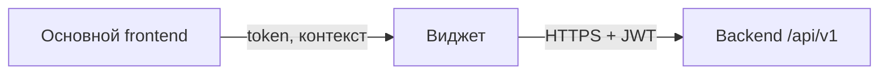

# Интеграция виджета с portalSoft

Документ для ТЗ: как виджет подключается к backend portalSoft.  
Виджет — **внешний HTTP-клиент**; к БД и внутренним API backend доступа нет.

---

## 1. Модель интеграции

Виджет встраивается в основной frontend portalSoft (iframe, micro-frontend или npm-блок) и работает через **REST API** основного приложения.



**Ожидание:** виджет **не вызывает** бизнес-домены portal (finance, warehouse, docs, task и т.д.).  
Собственные эндпоинты виджета (если появятся) описываются отдельно в ТЗ виджета.

---

## 2. Базовый контракт HTTP

| Параметр | Значение |
|----------|----------|
| Base URL | `{HOST}/api/v1/` |
| Формат | JSON (`Content-Type: application/json`) |
| Auth | `Authorization: Bearer <accessToken>` |
| Локализация ошибок | опционально заголовок `i18n` (например `ru`, `en`) |

Пример локально: `http://127.0.0.1:3000/api/v1/`

---

## 3. Аутентификация

### Рекомендуемый сценарий для виджета

Виджет **не логинится сам**, а получает `accessToken` от host-приложения (portal frontend):

- `postMessage` из родительского окна, или
- общий модуль auth / axios interceptors portal.

Это избавляет от дублирования OTP-flow внутри виджета.

### Если нужен самостоятельный login

Двухшаговый вход (как в portal):

1. `POST /auth/login` — `{ email, password }` → отправка OTP на email.
2. `POST /auth/login_otp` — `{ email, code }` → tokens + user.

Ответ шага 2:

```json
{
  "tokens": {
    "accessToken": "...",
    "refreshToken": "..."
  },
  "user": {
    "id": "...",
    "email": "...",
    "role": "...",
    "companyId": "..."
  }
}
```

### Служебные auth-эндпоинты

| Метод | Путь | Назначение |
|-------|------|------------|
| GET | `/auth/me` | Текущий пользователь (проверка token) |
| POST | `/auth/refresh` | Обновление token (body: `{ token }`) |
| POST | `/auth/logout` | Выход |

### Multi-tenant

Данные пользователя привязаны к **`companyId`** из JWT. Backend подставляет tenant в защищённые операции; виджет не должен подменять `companyId` в запросах.

### Роли

У пользователя есть `role` (например `ADMINISTRATOR`, `COMPANY_ADMINISTRATOR`, `CUSTOMER`, …).  
Часть эндпоинтов portal ограничена ролями. Для виджета в ТЗ указать, какие роли допускаются к UI виджета.

---

## 4. CORS и размещение

Backend читает список разрешённых origins из `CORS_ORIGINS` (через запятую).

| Окружение | Поведение |
|-----------|-----------|
| development | при пустом `CORS_ORIGINS` — разрешены все origins |
| production | origin виджета **обязан** быть в `CORS_ORIGINS` |

### Варианты размещения

| Вариант | Auth |
|---------|------|
| Iframe в portal | token от родителя через `postMessage` |
| Micro-frontend / npm в portal | общий auth-слой portal |
| Отдельный origin | свой login или SSO; origin в `CORS_ORIGINS` |

Готового widget SDK / iframe-контракта в backend нет — **postMessage и CSP описываются в ТЗ виджета** совместно с frontend-командой.

---

## 5. Формат ошибок

Все ошибки API возвращаются JSON:

```json
{
  "message": "Текст или объект полей",
  "alertCode": "WRONG_PASSWORD",
  "statusCode": 401
}
```

- **422 (validation):** `message` — объект `{ "fieldName": ["ошибка"] }`.
- UI виджета должен показывать `message` и/или маппить `alertCode` на тексты (как в основном portal).

Типичные коды auth: `USER_NOT_FOUND`, `WRONG_PASSWORD`, `INVALID_OTP_CODE`, `SESSION_NOT_FOUND`.

---

## 6. Healthcheck

Для проверки доступности backend:

| Метод | Путь | Назначение |
|-------|------|------------|
| GET | `/health/ping` | быстрый ping gateway |
| GET | `/health` | статус внутренних модулей |

Не требует авторизации.

---

## 7. Что виджету не нужно

- Прямой доступ к PostgreSQL.
- WebSocket / чаты (если виджет их не использует).
- Upload файлов через `/files` (если не заложено в ТЗ виджета).
- Знание внутренней архитектуры backend (monolith, Drizzle, in-process handlers).

---

## 8. Чеклист для ТЗ виджета

1. **Base URL** по окружениям (dev / staging / prod).
2. **Способ auth:** token от portal vs свой login.
3. **postMessage-контракт** (если iframe): какие поля передаются (`accessToken`, `user`, `companyId`).
4. **Origin виджета** для `CORS_ORIGINS` на prod.
5. **Роли:** кто видит виджет.
6. **Собственные API виджета** — список методов, request/response (отдельная секция ТЗ).
7. **Обработка ошибок** — `alertCode` + `message`.
8. **Refresh token** — кто обновляет (portal или виджет).

---

## Quick reference

```
Base URL:   https://<host>/api/v1/
Auth:       Authorization: Bearer <accessToken>
Tenant:     companyId из JWT / от host-приложения
Errors:     { message, alertCode, statusCode }
Health:     GET /health/ping
```
